# 🚛 Autonomous Fleet Intelligence Engine

**A WhatsApp-first AI system that handles truck/bus breakdowns for a logistics company — end to end, without anyone needing to install an app.**

🔗 **Live App:** [fleet-swarm-project.vercel.app](https://fleet-swarm-project.vercel.app/)

> Think of it as an AI operations manager that never sleeps: the moment a truck breaks down, it diagnoses the problem, finds the nearest repair shop, gets spare-part prices from vendors, negotiates the best deal, and keeps the driver, the fleet manager, and the vendor all talking to each other — over plain WhatsApp.

**At a glance:** FastAPI + Gemini + hybrid RAG backend · React dashboard · Meta WhatsApp Cloud API · SQLite state · CI-tested · [MIT licensed](#-license)

**Quickstart (backend):**

```bash
cd backend && pip install -r requirements.txt && cp .env.example .env
uvicorn main:app --reload      # runs in safe simulated mode without API keys
```

Details: [how it works](#-how-it-works-the-actual-flow) · run it yourself (below) · [security notes](#-security-notes) · [tests](#-testing--reliability)

---

## 📖 What problem does this solve?

If you run a fleet of trucks or buses (this project is built around a real logistics company, **Beekay Infra & Logistics**, operating in Bihar, India), a breakdown on the highway today usually looks like this:

- Driver calls the manager → manager is busy or driving → call goes unanswered
- Manager has no idea what's actually wrong with the vehicle
- Someone has to manually search for a nearby mechanic/workshop
- Someone has to call 2-3 spare-part vendors, ask prices, and negotiate
- Nobody tracks whether the truck ever actually got fixed
- If the same truck breaks down for the same reason every month, nobody notices the pattern

This project replaces that entire chaotic phone-call process with **one WhatsApp conversation per person** — the driver chats with the bot, the manager chats with the bot, and the vendor chats with the bot. The AI in the middle does the diagnosis, the routing, the price comparison, and the follow-up.

**No app to install. No training needed. If someone can use WhatsApp, they can use this system.**

---

<details>
<summary><b>🎯 Real, practical use cases</b> (click to expand)</summary>


1. **A driver's truck breaks down on a highway at 2 AM.** He opens WhatsApp and either types the problem, sends a **voice note** in Hindi/Hinglish, or just **sends a photo** of the damaged part. The AI understands it, figures out the likely fault, and finds the nearest authorized service center automatically (using live Google Maps data).
2. **The fleet manager gets an instant WhatsApp alert** with the vehicle, issue, nearest workshop, and AI-suggested spare part — with **Approve ✅ / Reject ❌** buttons. No app, no dashboard login needed, no typing.
3. **The manager rejects a workshop** (too far / bad reviews) → the system **automatically reroutes to the next nearest one** and re-asks for approval — instead of the manager having to search again.
4. **Before any part is bought, 2–3 nearby vendors are contacted automatically** on WhatsApp, asked for price & availability, and the AI even **negotiates one round** if a vendor's price is higher than a competitor's (without ever leaking the competitor's exact price). The manager just picks the best price with one tap.
5. **The driver sends a photo of a damaged part any time during the repair.** If it's something small and safe (a loose wire, low coolant, a blown fuse), the AI gives the driver **step-by-step DIY instructions** right there in the chat — saving a mechanic visit entirely. If it's serious, it escalates to the manager immediately, flagged by severity (LOW/MODERATE/HIGH/CRITICAL).
6. **If a driver says "accident" or "aag lag gayi" (fire) or similar,** the AI detects the emergency instantly and fires a separate 🆘 CRITICAL alert to the manager — it doesn't wait in the normal message queue.
7. **If a driver goes quiet after a repair is dispatched,** the AI proactively checks in on its own ("kaisi chal rahi hai repair?") instead of the manager having to remember to follow up.
8. **If the same vehicle keeps breaking down with a similar issue** (e.g. radiator problems 3 times in 90 days), the manager sees a 🔁 **Predictive Maintenance Alert** right on the very first approval message — before approving yet another one-off repair, they're nudged to book a full inspection instead.
9. Every diagnosis the AI makes and a human later verifies is **permanently learned** — so the next time a similar issue comes up, the system answers with confidence from its own growing knowledge base instead of guessing again.

</details>

---

## 🧠 How it works (the actual flow)

```
   DRIVER                    AI ENGINE (this project)                 MANAGER              VENDOR
     │                                │                                  │                    │
     │──(text / voice / photo)───────▶│                                  │                    │
     │                                │  1. Understands the problem       │                    │
     │                                │     (Gemini + Hybrid RAG search   │                    │
     │                                │      over real repair manuals)    │                    │
     │                                │  2. Finds nearest workshop        │                    │
     │                                │     (Google Maps + Places)        │                    │
     │                                │  3. Sends Approve/Reject alert ──▶│                    │
     │                                │                                  │──Reject──▶ auto-reroute to next hub
     │                                │                                  │──Approve──┐          │
     │                                │  4. Asks 2-3 vendors for price ─────────────┼─────────▶│
     │                                │                                  │          │◀─price────│
     │                                │  5. Negotiates if needed ───────────────────┼─────────▶│
     │                                │  6. Shows manager best price ◀──────────────┘          │
     │                                │                                  │──picks vendor──▶     │
     │◀──"Accept Repair" button───────│                                  │                    │
     │──taps Accept──────────────────▶│  Chat is now LIVE with AI agent  │                    │
     │──(sends photo mid-repair)─────▶│  7. Vision AI diagnoses photo    │                    │
     │◀──DIY steps OR "help coming"───│     (self-fix if safe, escalate  │                    │
     │                                │      to manager if serious) ────▶│                    │
     │                                │  8. If driver goes silent,       │                    │
     │◀──proactive check-in───────────│     follows up automatically     │                    │
```

Everything above happens through **one Meta WhatsApp Business number** — the "AI Engine" box is a FastAPI backend that receives every WhatsApp message as a webhook, decides who sent it (driver / manager / vendor) and what they mean, and replies instantly.

---

## 📊 Pilot metrics — real numbers, not marketing claims

Rather than quote an impressive-sounding "cut dispatch time by X%" figure with nothing behind it, the system **instruments and measures itself**: every incident's clock starts the moment it's triaged, and stops the moment a mechanic/part is genuinely approved & dispatched (whether through the direct manager Approve, or after a vendor price comparison). This is real, live-collected data — pull it any time from `GET /api/metrics/summary`:

```json
{
  "total_incidents_triaged": 14,
  "total_incidents_dispatched": 11,
  "avg_breakdown_to_dispatch": "6.2 min",
  "median_breakdown_to_dispatch": "4.8 min",
  "fastest_dispatch": "1.4 min",
  "slowest_dispatch": "19.1 min",
  "dispatched_via_breakdown": { "vendor_price_comparison": 7, "direct_manager_approve": 4 }
}
```

*(the numbers above are an illustrative shape, not a claimed result — a fresh deployment starts at zero and this fills in with genuine numbers as real incidents flow through it. On a manual, phone-call-based process, the same "breakdown reported → workshop and part confirmed" step commonly takes 30 minutes to a few hours, since it depends on the manager being reachable and free to make several calls — this endpoint is what makes an honest before/after comparison possible once the system has a real pilot's worth of incidents behind it, instead of guessing.)*

---

## 🔄 Does it "auto-update" itself?

**Yes — the system has a Self-Improving Knowledge Base, but it only learns from human-verified answers, never silently on its own.** Here's exactly how it works:

1. A new/unusual breakdown comes in that doesn't match anything in the existing repair-manual knowledge base confidently.
2. The system falls back to a **live Gemini AI diagnosis** for that one incident — and it's honestly labeled *"AI-Generated Diagnosis — not from a certified manual, verify before dispatch"*, never shown with fake manual-level confidence.
3. If the **manager taps Approve** on that diagnosis, that's treated as human verification — and **only then** does the system permanently save it into its own knowledge base (it also writes it to disk so it survives redeploys).
4. The **very next time** a similar issue comes in — for any vehicle, not just this one — it's matched instantly with high confidence, straight from the learned manual, no Gemini guessing needed.

So it's "auto-update, but with a human in the loop" by design: an AI guess only becomes permanent knowledge after a real person has actually signed off on it. This is a safety choice — it stops one bad AI guess from quietly poisoning the knowledge base for every future incident.

*(Separately, and fully automatically with no approval needed: the system also tracks each vehicle's breakdown history on its own, and flags the manager if the same vehicle keeps having similar problems — see "Per-vehicle predictive maintenance" below.)*

---

<details>
<summary><b>✨ Complete feature list (every functionality, big and small)</b> (click to expand)</summary>


### 🧠 Core AI / Agentic pipeline
- **Multi-Agent Swarm architecture** — Triage & Vision Agent → Hybrid RAG Diagnostics Agent → Routing & Logistics Agent → Manager-Approval/ERP Agent, each one logged and traced independently.
- **Hybrid Search RAG** — combines real BM25 keyword search with vector similarity + cross-encoder reranking over an expandable knowledge base of vehicle repair manuals (drop in more `.json` manual files any time, no code change needed).
- **Corrective RAG (CRAG) with a hallucination grader** — before recommending a spare part, the system checks the part is actually grounded in the retrieved manual text, not just a plausible-looking guess.
- **Self-Improving Knowledge Base** — see the "auto-update" section above.
- **Multi-Modal Vision (Gemini Vision)** — real photo analysis, both at the initial report stage (`image_url`) and any time later in the WhatsApp chat.
- **Full observability tracing** — every agent step is logged with its own trace ID, latency, and payload, in a LangSmith/Arize-style format, viewable per-incident.

### 📍 Finding the nearest workshop (Routing & Logistics Agent)
- **Live Google Places search** for authorized Tata/Eicher heavy-commercial workshops near the breakdown point, with a built-in fallback list of real Bihar hubs (Patna, Muzaffarpur, Gaya, Bhagalpur, Darbhanga, Purnia, Begusarai) if the API has no results.
- **Statewide vs. metro search scope** — automatically searches all of Bihar if the breakdown is outside Patna, or narrows to Patna metro if it's inside the city.
- **Distance-based sorting** — hubs are ranked by real straight-line (haversine) distance from the breakdown point, closest first.
- **Automatic de-duplication** — the same workshop showing up from multiple search queries is only listed once, capped at the 5 closest.
- **One-tap full route on Google Maps** — origin → workshop → final destination, as a single clickable link with the workshop as a waypoint.
- **Live distance & ETA** pulled from the Google Directions API, broken down leg-by-leg (breakdown→workshop, workshop→destination).
- **Automatic hub phone lookup** via Google Place Details, so the manager always gets a real contact number, not just a name.

### ✅ Manager approval flow
- **Approve / Reject buttons** on WhatsApp — no typing needed for the main decision.
- **Natural-language understanding too** — a manager can just type instructions in plain Hindi/Hinglish/English instead of tapping a button, and the AI classifies it into the right action (approve, reroute to a local mechanic, reject, answer an info request, log a custom instruction, etc.).
- **Automatic hub re-routing on Reject** — instantly re-offers the next-nearest workshop with a fresh Approve/Reject card, cycling through up to 5 hubs before giving up and asking for manual input.
- **Direct, specific answers to questions** — if the manager asks for a phone number or a detail that's already known, the AI gives the real value immediately instead of a vague "will share shortly."

### 💰 Spare-Part Price Comparison & Negotiation
- **Multiple vendors contacted in parallel** automatically (real nearby vendors from Google Places, or a configurable test list while demoing).
- **Yes/No availability buttons** sent to each vendor — no free-text parsing needed for that step.
- **Automatic one-round negotiation** — if a vendor's price is higher than a competitor's, the AI asks them to reconsider, without ever revealing the competitor's exact number.
- **40-second safety-net timer** — even if not every vendor has replied yet, the manager still gets whatever quotes are ready instead of waiting indefinitely for a vendor who never responds.
- **Side-by-side price comparison with pick-one buttons** for the manager, sorted cheapest-first with a "✅ Best" tag.
- **Automatic plain-text fallback** if the interactive buttons fail to deliver for any reason — the manager never gets left with nothing.
- **Vendor confirmation instantly triggers the driver's dispatch message**, with the vendor name, price, and hub contact included.

### 📲 WhatsApp-native driver experience
- **Text, voice note, or photo — driver's choice.** Voice notes are transcribed and understood directly in Hindi/Hinglish/regional languages, and can even auto-create a full incident report on their own.
- **"Accept Repair" button** — the AI chat only activates for a driver once they've confirmed, so there's no ambiguity about who's actively being helped.
- **In-chat Photo Diagnosis, any time** — not just at the initial report. Send a photo of any part, any time during the repair, and get an instant AI assessment.
- **Self-Service Repair Guidance (DIY steps)** — for genuinely minor, safe issues (a loose connector, low coolant, a blown fuse), the driver gets step-by-step fix instructions instead of an automatic mechanic dispatch. The AI is deliberately restricted from ever suggesting self-fixes for brakes, steering, fuel systems, or anything involving a running engine.
- **Automatic severity grading from photos** (LOW/MODERATE/HIGH/CRITICAL) — serious damage is escalated to the manager immediately, with the photo forwarded where possible.
- **Live location forwarding** — a driver's shared WhatsApp location goes straight to the manager with a clickable map pin.
- **Nudge to share live location** whenever a driver gives a status update, since WhatsApp only allows the driver to share their own location — the system can't pull it automatically.

### 🌐 Language & urgency intelligence
- **Automatic language/script matching** — the AI always replies in whatever script the sender just used (Devanagari Hindi, Hinglish, or English), never mixing or switching on its own.
- **Urgency detection on every message** — silently scored NORMAL / URGENT / CRITICAL. A message suggesting an accident, fire, or injury fires an instant, separate 🆘 alert to the manager rather than waiting in the normal reply.
- **Keyword-based safety net** — even if the AI service is temporarily unavailable, a lightweight keyword check still catches genuinely critical situations (accident, fire, injury) and escalates them.

### 🔁 Follow-up & predictive intelligence
- **Proactive driver follow-up** — if a driver goes silent for a configurable amount of time after a repair is dispatched, the AI checks in on its own ("kaisi chal rahi hai repair?") instead of the manager having to remember.
- **Per-vehicle predictive maintenance** — every incident is logged against its vehicle; if the same vehicle has a similar issue repeatedly within a configurable time window, the manager sees a 🔁 warning right on the approval card, before approving yet another one-off fix.

### 🔒 Reliability, safety & engineering
- **SQLite-backed persistent state** for every incident, approval, quote, vehicle history, and driver-activity timestamp — none of it lives only in memory, so a server restart/redeploy doesn't wipe anything out.
- **Fail-closed API-key protection** on the endpoints the dashboard calls (`/api/triage`, `/api/send-whatsapp-interactive`), so outsiders can't rack up Gemini/Maps/WhatsApp API costs.
- **Rate limiting** (20 requests/minute per IP) on those same endpoints as a second layer of abuse protection.
- **CORS configured** so the frontend (Vercel) and backend (Render) can talk to each other even though they're hosted separately.
- **Graceful fallbacks everywhere** — if `GEMINI_API_KEY`, `GOOGLE_MAPS_API_KEY`, or `WHATSAPP_TOKEN` isn't set, the relevant feature simply simulates/skips instead of crashing the whole app.
- **Opt-in debug endpoints** (`ENABLE_DEBUG_ENDPOINTS=true`) — inspect any in-flight vendor quote's live status, clear stale test data, or test the Gemini connection directly (see the endpoint table below).

</details>

---

## 📸 See it in action

### 🎬 The full flow, at a glance


*(This is a captioned slideshow of real screens from the six sections below, not a screen recording — it's here to give a 20-second feel for the "no app needed" experience before you scroll through the actual conversations. For a true 30-second WhatsApp-to-WhatsApp screen recording, see the note in [Roadmap](#roadmap--current-limitations) below.)*

### 1. The Manager's Dashboard (web app)
This is where an incident is first reported/injected into the system — either by an admin, or automatically when a driver reports a breakdown by voice note. It runs the full Agentic RAG pipeline and shows the diagnosis live.

| Reporting a breakdown & getting a manual-grounded diagnosis | A trickier issue falling back to live AI diagnosis |
|---|---|
| 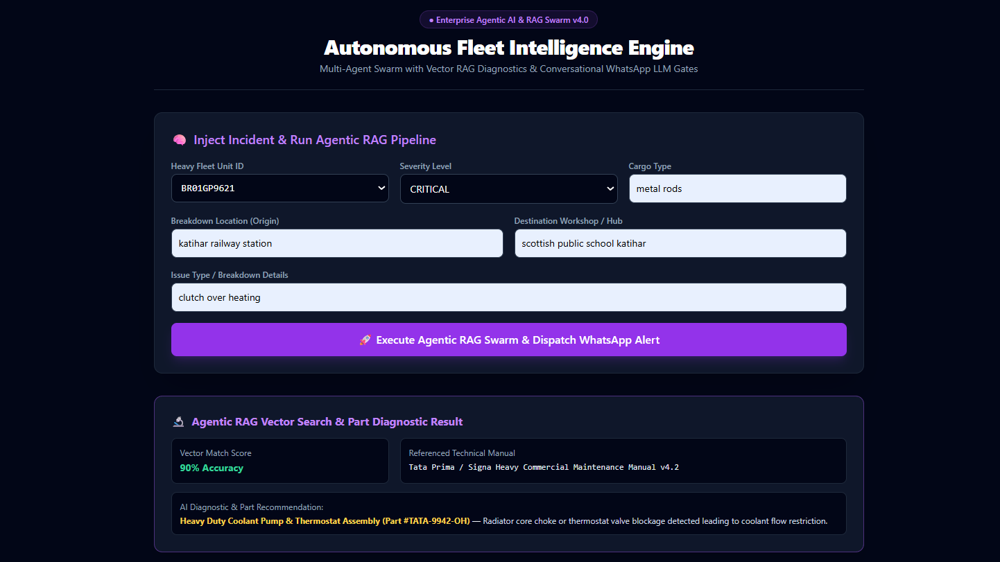 | 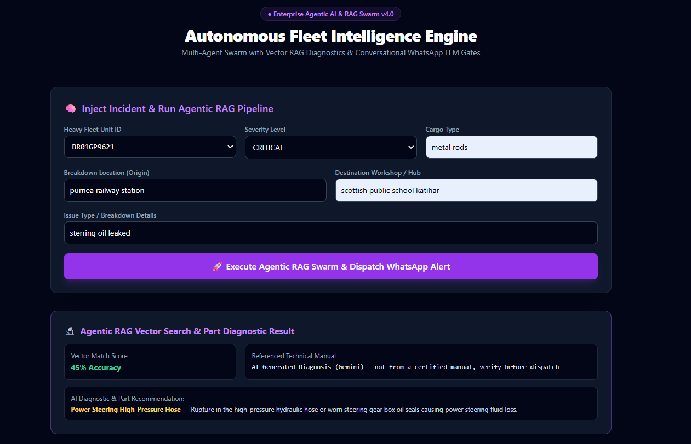 |
| Clutch overheating → matched instantly to the Tata Prima manual at 90% confidence, with the exact spare part. | Steering oil leak → no manual matched confidently, so Gemini generates a real diagnosis on the spot, honestly labeled "AI-Generated" instead of faking manual-level certainty. |

### 2. The Driver's WhatsApp
The driver never sees a dashboard — everything happens in one chat thread with the fleet's WhatsApp number.

| Repair & parts confirmed | Tapping "Accept Repair" activates the AI agent |
|---|---|
|  | 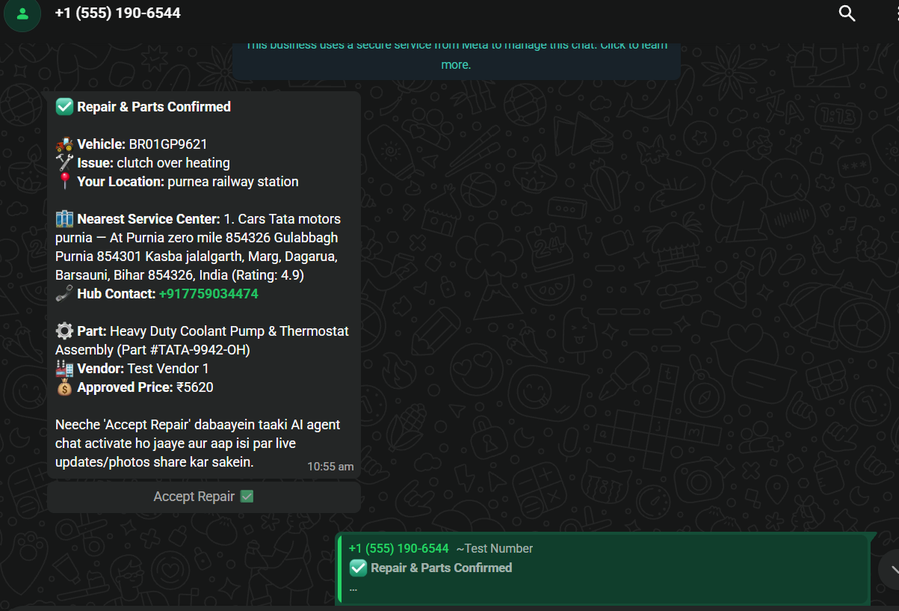 |

| Driver sends a photo mid-repair — AI diagnoses it instantly | Full AI diagnosis + natural back-and-forth chat |
|---|---|
| 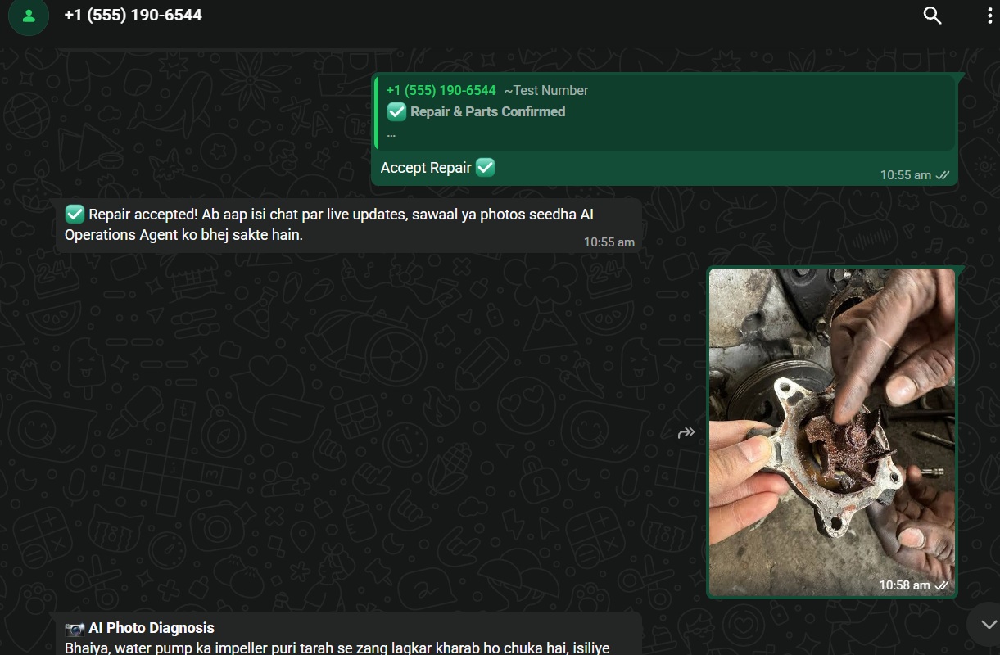 |  |

| Driver asks the AI to escalate to the manager | AI keeps the driver updated on dispatch status |
|---|---|
| 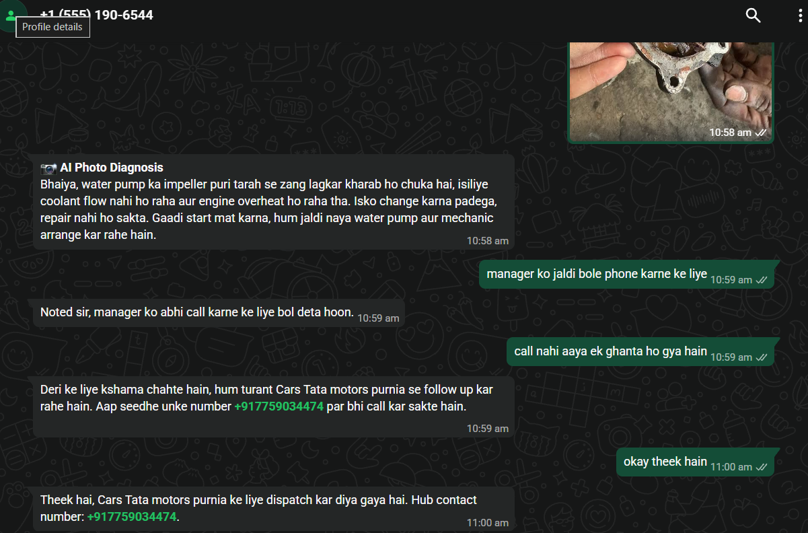 |  |

*(In this real conversation, the driver's water pump had failed completely — the AI correctly identified it as unrepairable, told the driver not to start the vehicle, and kept him informed while a replacement was arranged.)*

### 3. The Vendor's WhatsApp
Spare-part vendors near the breakdown location are contacted automatically — no manual phone calls by the manager.

| Vendor gets an availability enquiry with Yes/No buttons | AI negotiates the price down in real time |
|---|---|
| 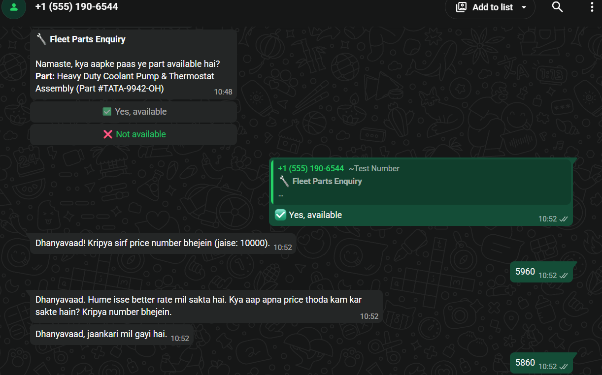 | 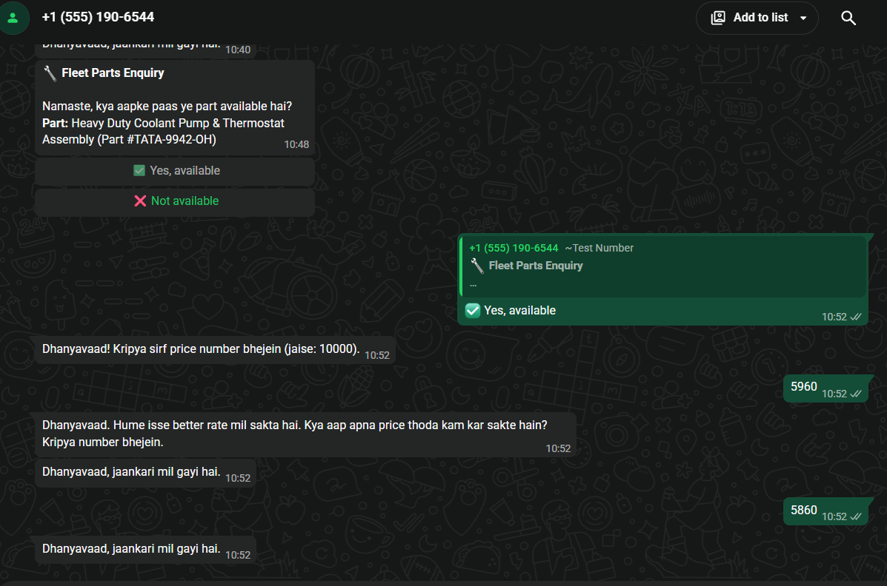 |

| A second vendor is contacted the same way, in parallel |
|---|
| 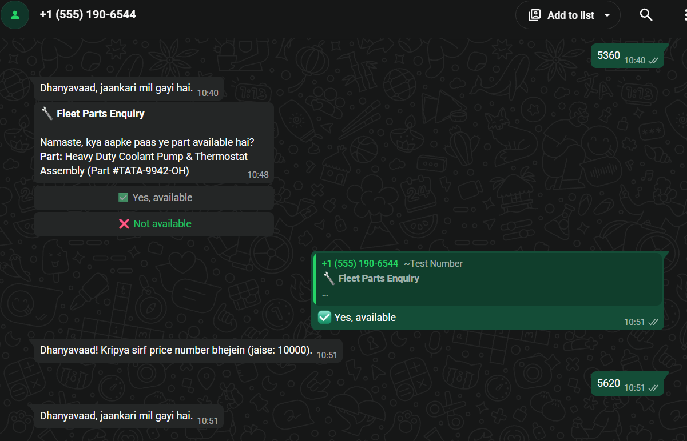 |

### 4. The Manager's WhatsApp
The manager makes every real decision with a single tap — no typing, no app.

| AI shows a side-by-side price comparison; manager picks the best one | Driver's mid-repair photo is escalated with a CRITICAL severity flag |
|---|---|
| 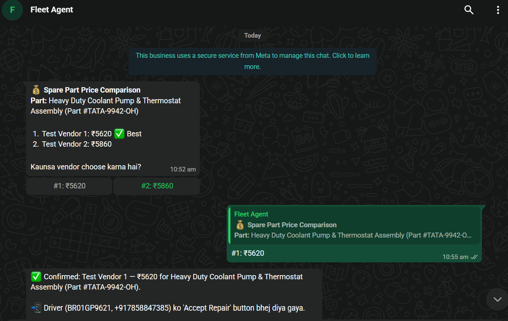 | 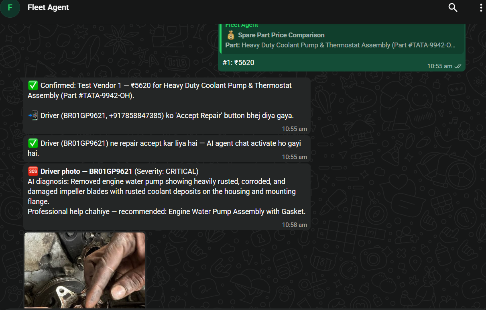 |

| The exact photo and AI diagnosis, with an emergency-level alert |
|---|
| 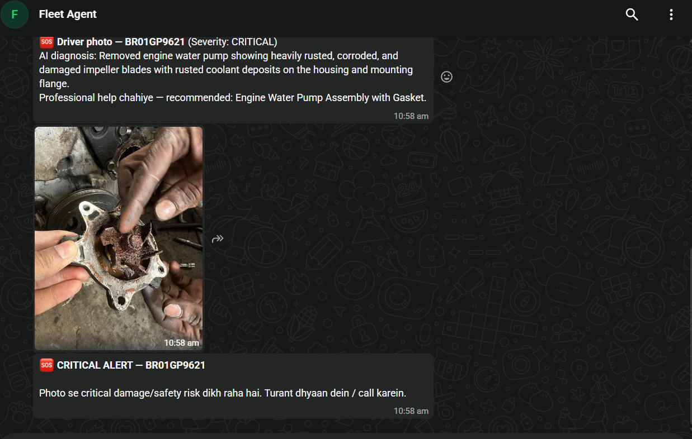 |

---

## 🏗️ Tech stack

| Layer | Technology |
|---|---|
| Backend API | Python, FastAPI |
| Frontend dashboard | React + Tailwind CSS (deployed on Vercel) |
| AI / LLM | Google Gemini (text + vision) |
| Search / RAG | BM25 + vector hybrid search, cross-encoder reranking |
| Maps & routing | Google Maps Places, Geocoding & Directions APIs |
| Messaging | WhatsApp Business Cloud API (Meta) |
| Persistence | SQLite (survives restarts/redeploys) |
| Hosting | Backend on Render, Frontend on Vercel |

---

## 📁 Project structure

```
fleet_intelligence/
├── .github/workflows/ci.yml       # CI: lint + the backend test suite on every push and PR
├── backend/
│   ├── main.py                    # Tiny entry point (`uvicorn main:app`) — the app lives in fleet/
│   ├── security.py                # Signature check, constant-time compare, rate limiter (stdlib only)
│   ├── fleet/                     # The application, one concern per module
│   │   ├── api.py                 #   FastAPI routes only — no business rules
│   │   ├── auth.py                #   Fail-closed API-key / webhook-signature / handshake checks
│   │   ├── config.py              #   Every environment variable, parsed once
│   │   ├── state.py, store.py     #   SQLite-backed state + the lock that guards it
│   │   ├── webhook/               #   Inbound WhatsApp: router, roles (who may do what), buttons, chat, media
│   │   ├── orchestrator.py        #   The triage pipeline behind /api/triage
│   │   ├── quotes.py, followup.py #   Vendor price comparison; proactive driver check-ins
│   │   ├── whatsapp.py, gemini.py #   Outbound clients (Meta Cloud API, Google Gemini)
│   │   ├── knowledge.py           #   Knowledge base, retrieval engine, corrective-RAG validator
│   │   └── netsafe.py             #   SSRF-safe fetching of caller-supplied image URLs
│   ├── advanced/                  # Hybrid search, self-RAG, multi-agent graph, observability, vision
│   ├── knowledge_base/            # Repair-manual documents (JSON) the RAG engine searches — add more any time
│   ├── tests/                     # Backend test suite (see Testing & reliability below)
│   └── requirements.txt
├── frontend/
│   ├── src/App.js                 # The manager's web dashboard (incident injection + live status)
│   └── ...
└── docs/screenshots/               # Screenshots + demo GIF used in this README
```

---

## ⚙️ Running it yourself

### Backend

```bash
cd backend
pip install -r requirements.txt
uvicorn main:app --reload
```

Copy `backend/.env.example` and fill it in. **Secrets are required, not optional:** if a security setting is missing the app refuses the request it protects (HTTP 503) rather than silently running open, and it prints exactly what is missing at startup. For local development only, `ALLOW_INSECURE_DEV=true` turns that off.

| Variable | What it's for |
|---|---|
| `FLEET_API_KEY` | **Required.** Protects `/api/triage` and `/api/send-whatsapp-interactive` (503 if unset) |
| `WHATSAPP_APP_SECRET` | **Required.** Meta App Secret — every webhook POST must carry a valid `X-Hub-Signature-256` (503 if unset, 403 if wrong) |
| `WHATSAPP_VERIFY_TOKEN` | **Required.** Token for Meta's webhook handshake (use the same value in Meta's console) |
| `MANAGER_WHATSAPP_NUMBER` | **Required.** The manager's number with country code, e.g. `+91XXXXXXXXXX`. Only this number can approve, reject or pick a vendor |
| `WHATSAPP_TOKEN` | Meta WhatsApp Business Cloud API access token (unset = sends are simulated) |
| `PHONE_NUMBER_ID` | Your WhatsApp Business phone number ID |
| `DRIVER_WHATSAPP_MAPPING` | JSON `{"VEHICLE_ID": "+91..."}` — which driver drives which vehicle. Env var or `FLEET_CONFIG_FILE` |
| `TEST_VENDOR_NUMBERS`, `TEST_HUB_NUMBERS` | Testing-only JSON lists (see `.env.example`); leave empty to use real nearby hubs |
| `FLEET_CONFIG_FILE` | Path to a JSON file holding the three settings above, so phone numbers never enter git |
| `GEMINI_API_KEY` | Powers all the AI understanding, diagnosis, vision, and language matching (unset = keyword fallback) |
| `GOOGLE_MAPS_API_KEY` | Nearby workshop search, geocoding, and route calculation (unset = built-in hub list) |
| `ALLOWED_ORIGINS` | Comma-separated CORS origins, e.g. your Vercel URL (default: any origin) |
| `FLEET_DB_PATH` | Where the SQLite file lives (default `backend/fleet_state.db`) — put it on a persistent disk |
| `ENABLE_DEBUG_ENDPOINTS` | `true` exposes the three diagnostic endpoints (default off; they also need the API key) |
| `ALLOW_INSECURE_DEV` | **Local development only** — lets requests through when the secrets above are unset |
| `FOLLOWUP_CHECK_DELAY_SECONDS` | How long to wait before proactively checking in on a silent driver (default: 2 hours) |
| `PREDICTIVE_PATTERN_WINDOW_DAYS` | How far back to look for repeat issues on the same vehicle (default: 90 days) |
| `PREDICTIVE_PATTERN_MIN_REPEATS` | How many repeats before flagging a predictive-maintenance warning (default: 2) |
| `COHERE_API_KEY` | Optional Cohere API key for alternative reranking |
| `GEMINI_VISION_MODEL` | Optional Gemini model override for vision (default: `gemini-2.0-flash`) |
| `GEMINI_GRADER_MODEL` | Optional Gemini model override for RAG grading (default: `gemini-2.0-flash`) |
| `OTEL_EXPORTER_OTLP_ENDPOINT` | Optional OpenTelemetry collector endpoint |
| `LANGCHAIN_TRACING_V2` | Set to `true` to enable LangSmith tracing (default: disabled) |
| `LANGCHAIN_PROJECT` | LangSmith project name (default: `default`) |

The app runs as a **single instance** on SQLite: a process-wide lock keeps concurrent webhook messages and the quote/follow-up timers from overwriting each other's updates. Run one worker (`uvicorn main:app`, no `--workers N`).

### Frontend

```bash
cd frontend
npm install
npm start
```

Set `REACT_APP_API_URL` to point at your backend if it's not running locally, and `REACT_APP_FLEET_API_KEY` to the same value as the backend's `FLEET_API_KEY`. (Anything in a browser bundle is visible to visitors, so this key keeps casual abuse out — it is not a user login.)

---

## 🧪 Testing & reliability

A CI pipeline lints the code (`ruff`, undefined names / unused imports / syntax errors), checks every module compiles, and runs the full test suite with coverage, on every push and pull request.

Run the same checks locally:
```bash
cd backend
pip install -r requirements.txt -r requirements-dev.txt ruff
ruff check --select F,E9 .
pytest tests/ -v --cov=fleet --cov=security --cov-report=term-missing
```

The tests never touch the network or a real database: each test gets a fresh SQLite file, a recorder stands in for the WhatsApp API, and timers are fake (the test fires them).

| Test file | What it verifies |
|---|---|
| `test_webhook_flow.py` | The whole WhatsApp flow end to end through the real handlers: approve (and learning), reject → reroute → exhausted, the vendor flow (yes → price → negotiation → pick → driver accepts), driver chat/urgent escalation, photos, locations, voice notes, **who may press which button**, strangers being refused, retried deliveries ignored, per-sender rate limit, malformed payloads. |
| `test_triage_pipeline.py` | `/api/triage`'s pipeline with a fake retrieval engine: the incident is registered for approval, repeat issues are flagged, a vendor quote round opens, internal image URLs are never fetched, oversized fields rejected. |
| `test_security.py` | Signature verification, constant-time compare, the rate limiter, and the **fail-closed** rules (missing secret → 503, not open). HTTP-level checks run when FastAPI + httpx are installed (always in CI). |
| `test_netsafe.py` | SSRF protection: non-http schemes, loopback/private/link-local/metadata addresses, redirects into internal hosts, redirect loops, oversized bodies. |
| `test_config.py` | Settings parsing: blank values, bad numbers, JSON settings, config file, startup warnings. |
| `test_gemini_and_whatsapp.py` | The Gemini and WhatsApp clients against fake HTTP: parsing, fallbacks, retries, failure signalling, the corrective-RAG grades, learned-document dedupe. |
| `test_followup.py` | Follow-up timers: arming, quiet-driver check-ins, chaining, stopping, error containment. |
| `test_persistence.py` | The SQLite `PersistentDict` — persistence across instances, name validation, thread safety, and that the state lock prevents lost updates. |
| `test_knowledge_base.py` | The knowledge-base loader (malformed entries, duplicates, seed fallback) and that the shipped files are valid. |
| `test_logic.py` | Keyword extraction, predictive-maintenance alerts, learned documents, the keyword fallback used when the AI is down. |
| `test_hybrid_search.py` | The BM25/ranking logic itself. |
| `test_hygiene.py` | Guards: no phone numbers or secrets in source, `main.py` stays thin, no module grows into a monolith, every env var is documented. |

**What isn't tested:** anything that needs the real Meta, Gemini or Google Maps services (they are faked), and the React dashboard.

---|---|
| `test_hybrid_search.py` | The BM25/ranking logic itself — ties don't get a false index bias, distinct scores are ordered correctly, a genuine keyword match wins, and zero keyword overlap doesn't force a false-positive match. |
| `test_knowledge_base.py` | The knowledge-base loader — reading multiple JSON manual files correctly, skipping duplicate IDs instead of silently overwriting, and falling back to the built-in seed data if the folder is empty. |
| `test_logic.py` | Decision logic behind the webhook: keyword extraction, per-vehicle predictive-maintenance alerts (repeat threshold, time window, vehicle isolation), learned-knowledge documents, the keyword fallback used when the AI is down (including a regression test for substring false matches like "broken" ≈ "ok"), simulated-send mode, the API-key check and the per-IP rate limiter. |
| `test_security.py` | Webhook signature verification (valid, tampered, wrong secret, missing/malformed header), the Meta handshake, CORS origin parsing, and that every debug endpoint rejects requests without the API key. |
| `test_persistence.py` | The SQLite-backed `PersistentDict` layer — basic get/set/delete, missing-key behavior, and that data genuinely survives across separate instances (i.e. would survive a real server restart). |

**What isn't unit-tested yet:** the message-handling branches *behind* the webhook (voice, photo, button and chat handling that call Meta, Gemini and Google Maps live). They depend on three paid external APIs and are validated through manual/live testing instead (the screenshots above are real conversations). A mocked-API test suite for those branches is the natural next investment.

---

<details>
<summary><b>💵 Cost & scale — what running this actually costs</b> (click to expand)</summary>


This isn't a free system to run at scale — it calls three paid APIs per incident. Rough estimate per incident, based on current public pricing (September 2026; **always check the providers' own pricing pages, since these change often**):

| API | Typical calls per incident | Approx. cost per incident |
|---|---|---|
| **Google Maps** ([pricing](https://developers.google.com/maps/billing-and-pricing/pricing)) | 1–2 Places Text Search calls (nearest workshop), 1 Geocoding call, 1–2 Directions calls, 1 Place Details call (hub phone) | ~$0.08–$0.12 (Places Text Search, at ~$32/1,000 requests, is the dominant cost here) |
| **Google Gemini** ([pricing](https://ai.google.dev/gemini-api/docs/pricing)) | 1 diagnosis/CRAG-fallback call, 0–3 photo-diagnosis vision calls, 0–3 vendor price-extraction calls, 0–2 driver chat replies | ~$0.005–$0.02 (Gemini Flash/Flash-Lite are priced in cents per million tokens — this is the cheapest piece by far) |
| **WhatsApp Business API (Meta)** | Roughly 15–25 messages total across driver, manager, and 2–3 vendors for one full incident | ~₹2–₹4 (~$0.02–$0.05) at the current ₹0.115/utility-or-service-message rate in India |

**Rough total: ~$0.10–$0.20 (₹9–₹18) per fully-handled breakdown incident** — which is negligible next to the cost of even an hour of truck downtime. Google Maps' Places Text Search is the single biggest line item; caching nearby-hub results per region (instead of a fresh search every incident) is the most effective place to cut cost at higher volume.

**Rate-limit headroom:** the app's own built-in limiter caps `/api/triage` and `/api/send-whatsapp-interactive` at 20 requests/minute per IP — that's protection against abuse of *this app*, separate from each provider's own quota (Gemini's free/paid tier request-per-minute limits, Google Maps' default queries-per-second cap, and WhatsApp's messaging-limit tiers, which scale up automatically as your number's quality rating and unique-recipients-per-24h history grow). For a production rollout across a larger fleet, check current headroom on each provider's own console before scaling up incident volume.

</details>

---

## 🔌 All API endpoints

| Endpoint | Purpose |
|---|---|
| `POST /api/triage` 🔑 | Runs the full Agentic RAG pipeline for a new incident |
| `POST /api/send-whatsapp-interactive` 🔑 | Sends the Approve/Reject card to the manager on WhatsApp |
| `GET /api/approval-status/{incident_id}` | Lets the dashboard poll for the manager's decision |
| `GET` / `POST /api/whatsapp-webhook` | Meta's webhook verification, and where every incoming WhatsApp message (driver/manager/vendor) actually lands and gets handled |
| `GET /api/health` | Simple health/uptime check |
| `GET /api/metrics/summary` | Real, live-collected pilot metrics — average/median/fastest/slowest breakdown-to-dispatch time across every incident so far (see [Pilot metrics](#-pilot-metrics-real-numbers-not-marketing-claims) above) |
| `GET /api/debug-pending-quotes` 🔑🛠 | Shows the live, real-time state of every in-flight vendor price quote (who's replied, who's still waiting, what prices came in) |
| `POST /api/debug-clear-pending-quotes` 🔑🛠 | Clears out stale/test vendor-quote data before a fresh test run |
| `GET /api/test-gemini` 🔑🛠 | Quick one-click check that the `GEMINI_API_KEY` and Gemini connection are working |

🔑 = requires the `X-API-Key` header (HTTP 503 if `FLEET_API_KEY` is not configured). 🛠 = only exists when `ENABLE_DEBUG_ENDPOINTS=true`; otherwise 404. The webhook is instead authenticated by Meta's HMAC signature (`WHATSAPP_APP_SECRET`).

---

## 🔒 Security notes

- **Fail closed:** a missing `FLEET_API_KEY` or `WHATSAPP_APP_SECRET` means the protected endpoints answer 503; they never silently run open. `ALLOW_INSECURE_DEV=true` is the one explicit, loudly-logged way to switch that off for local work.
- **Webhook authenticity:** every POST must carry a valid `X-Hub-Signature-256` (constant-time check over the raw body).
- **Authorization, not just authentication:** a signed message proves Meta delivered it, not that the sender may act. Approve / Reject / Pick-vendor work only from `MANAGER_WHATSAPP_NUMBER`; "Accept Repair" only from that incident's driver; a vendor's Yes/No only from that vendor. Strangers can't chat with the AI agent or read incident details, and the old "use the most recent incident" fallback is gone.
- **Abuse limits:** per-IP limit on the API, per-sender limit on the webhook, Meta retries de-duplicated by message id, input length caps.
- **SSRF protection:** the `image_url` on `/api/triage` is fetched only if it is a public http(s) address (every redirect hop re-checked, size capped), so it can't be used to reach internal services or cloud metadata.
- **Secrets stay out of URLs and logs:** the Gemini key is sent in a header, and logs record payload size only — never phone numbers or message text.
- **Debug endpoints are off by default** (`ENABLE_DEBUG_ENDPOINTS`), and the old `/api/debug-api-key` endpoint was removed.
- **Phone numbers and keys are configuration, not code:** drivers, test vendors and hubs come from env vars or `FLEET_CONFIG_FILE`.
- **Your action needed:** the previous default API key and webhook verify token, and the phone numbers that used to be in `main.py`, still exist in git history. Rotate the keys (`FLEET_API_KEY`, `WHATSAPP_VERIFY_TOKEN` + Meta's console). Scrubbing history needs a force-push, which is your call.

---

## 🚧 Roadmap & current limitations

- **No real screen-recorded demo yet.** The GIF above is a slideshow of real screenshots, not a live screen capture. The single highest-impact next step for anyone pitching this is a genuine 30-second phone screen recording: open WhatsApp as the driver, send a photo, show the manager's phone getting the alert and tapping Approve, show the vendor replying with a price — that sells the "zero app install" pitch better than any amount of text or static images.
- The free hosting tier (Render) can "sleep" when idle — background timers (like the proactive follow-up) reset if the server restarts, though all incident data itself is safely persisted.
- Forwarding a driver's actual photo to the manager (not just the AI's text description of it) is best-effort and depends on your WhatsApp Business setup — the text diagnosis always goes through regardless.
- Vendor phone numbers are a test list for demoing the price-comparison flow; set `TEST_VENDOR_NUMBERS` / `TEST_HUB_NUMBERS` to `[]` (the default) to use real nearby hubs found via Google Places.
- Single instance only: state is SQLite and one in-process lock serialises webhook handling, so scaling out needs a shared database and distributed locking first.

---

## 📄 License

This project is licensed under the MIT License. See the [LICENSE](LICENSE) file for details.
